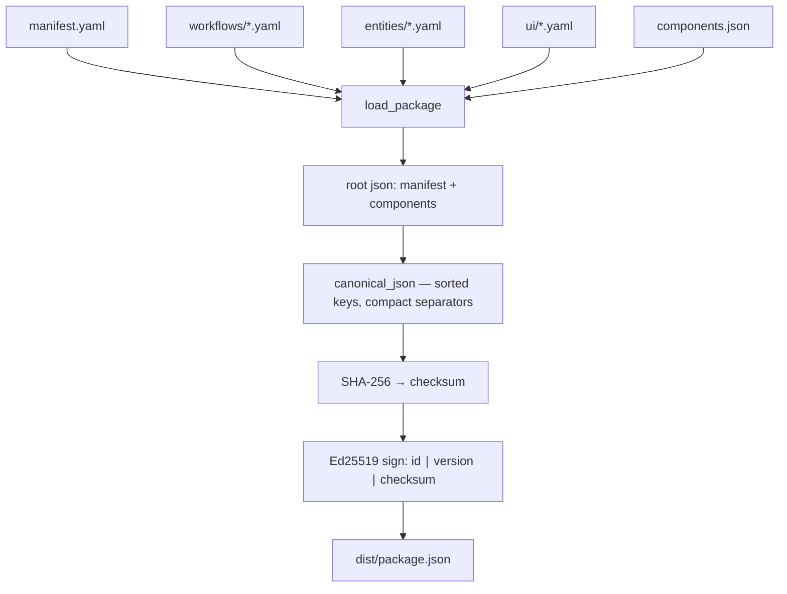

# Packaging

Packaging turns your solution directory into a single immutable artifact:
a canonical JSON document with a SHA-256 checksum and an Ed25519
signature. The registry accepts nothing else.

:::info Hosting
**Metadata Marketplace Apps** (`hosting: runtime`) must include `entities/`
and must **not** declare an external `/qefro` `endpoint` — publish rejects
it. A stray `src/` directory is tolerated by both `qefro app validate` and
`qefro solution build` (neither looks for its absence), so it is a convention
rather than a gate.
`qefro app package` / `qefro solution build` accept that shape.

SDK connections (`hosting: external`) require `src/` — `app validate` bails
with `missing src/ directory — external SDK connections require a /qefro
process` (`main.rs:1458-1459`). See
[Runtime vs SDK](/docs/solutions/runtime-vs-sdk).
:::

## Build command

```bash
qefro app package .
# alias of: qefro solution build .
```

Output (verbatim shape from `qefro-cli/src/main.rs:767-770`):

```text
built restaurant-pro@1.0.0
  checksum:  9f2c1e…
  signature: 71ab04…
  package:   ./dist/package.json
```

The signed package is written to `dist/package.json` inside the solution
directory.

## Two ingest paths, two assemblers

There are **two** ways a package reaches the catalog, and only one of them
runs on your machine:

| Path | Assembler | Sees `assets/`? | Auth |
| --- | --- | --- | --- |
| `POST /v1/solutions/publish` — the CLI (`qefro solution publish`, `qefro app package` then publish) | `qefro-cli::load_package` reads your directory | **No.** Assets are a separate admin call. | `x-qefro-admin-id` ∈ `QEFRO_PLATFORM_ADMIN_IDS` |
| `POST /v1/tenant/packages/upload` → `/commit` → `/publish` | `solution/zip_assemble.rs::assemble_from_extracted`, server-side, from the uploaded ZIP | ZIP members are read into the same `PublishPackageComponents`; the per-file ceilings still apply only to the asset-upload route | tenant headers |

The rest of this page describes the **CLI** path.

## Assembly steps



1. **Assemble.** `load_package` reads `manifest.yaml`, then resolves each
   `flows:` entry to `workflows/<id>.yaml`, each `entities:` entry to
   `entities/<id>.yaml`, and the `ui/` files into one UI object. An optional
   `components.json` still overrides `settings` / `onboarding` / `policies` /
   `channels` / `migrations`. **Assets are not read here.**
2. **Canonicalize.** The document `{manifest, components}` is serialized to
   canonical JSON — object keys sorted recursively, compact separators
   (`main.rs:214-231`).
3. **Checksum.** SHA-256 of those canonical bytes.
4. **Sign.** Ed25519 signs the UTF-8 message `{id}|{version}|{checksum}`
   (`main.rs:752`, mirrored by `validator.rs:642` `signing_message`).
5. **Emit.** Exactly five top-level keys (`main.rs:756-762`):

```json
{
  "manifest": { "...": "the parsed manifest, verbatim" },
  "components": { "workflows": [], "prompts": [], "settings": {}, "onboarding": [], "policies": [], "channels": {}, "migrations": [], "ui": {}, "entities": [], "events": [] },
  "signature": "hex…",
  "signature_kid": "k1",
  "publisher_id": "11111111-2222-3333-4444-555555555555"
}
```

There is **no `checksum` field** in the artifact. The server recomputes it —
see the contract below.

:::caution The checksum is re-derived server-side, from a typed DTO
`publish_package` calls `parse_and_validate(&req.manifest, &req.components)`
and validates the signature against `pkg.checksum` — i.e.
`package_checksum(manifest_value, components)` where `components` is
`serde_json::to_value()` of the **typed** `PublishPackageComponents` struct
(`validator.rs:402, 622-626`). Your raw JSON is round-tripped through that
struct first.

`PublishPackageComponents` has 13 fields. Ten always serialize
(`workflows`, `prompts`, `settings`, `onboarding`, `policies`, `channels`,
`migrations`, `ui`, `entities`, `events`); three carry
`skip_serializing_if = "Vec::is_empty"` (`http_tools`, `connections`,
`actions`). So an empty `"connections": []` you emit is **dropped** on the
server's re-serialization, and any key you add that the struct does not have
is dropped too. Either way the canonical bytes change and the signature no
longer matches. The failure is not "invalid signature format" — it is
HTTP **422** `invalid_signature` (`InvalidSignature(name, version)`), because
the recomputed checksum differs from the one you signed.
:::


## Signing keys

The CLI tries, in order (`main.rs:233-256`):

| Source | Setting | Behaviour |
| --- | --- | --- |
| Environment variable | `QEFRO_SIGNING_KEY_HEX` | 32 bytes of hex. Checked first with a plain `env::var`, so **any** set value wins — including an empty one, which then fails with `QEFRO_SIGNING_KEY_HEX must be 32 bytes of hex` instead of falling through to the keys file. |
| Keys file | `QEFRO_KEYS_FILE`, default `~/qefro/tmp/e2e-keys/prod.env` | Scanned line by line for `REGISTRY_PRIVATE_KEY=<hex>`. Missing file → `no signing key: set QEFRO_SIGNING_KEY_HEX or provide {path}`; present but no such line → `REGISTRY_PRIVATE_KEY not found in {path}`. |

The publisher identity comes from `QEFRO_PUBLISHER_ID`, defaulting to the
built-in `11111111-2222-3333-4444-555555555555` (`main.rs:28, 150-152`).
Publish requires that id to be listed in solution-service
`QEFRO_PLATFORM_ADMIN_IDS`; with an empty allowlist and
`QEFRO_PUBLISH_OPEN=true` any well-formed `x-qefro-admin-id` is accepted
(local/dev only), and otherwise publish is refused with
`platform admin allowlist not configured (set QEFRO_PLATFORM_ADMIN_IDS)`
(403). See [Publishing](/docs/solutions/publishing).

:::caution `signature_kid` is hardcoded `k1`
`build_package` always writes `"signature_kid": "k1"` (`main.rs:759`). There
is no flag or environment override. `verify_package_signature_any` uses the
kid as a **filter**: with `kid = Some("k1")` it tries only the key registered
as `k1` and skips the rest (`validator.rs:682-691`). So if the deployment
registers your public key under a different kid — `SOLUTION_PUBLIC_KEYS=k2:<hex>`
— the CLI path cannot verify, and publish fails with 422 `invalid_signature`
even though the signature itself is correct. Either register the key as `k1`
or publish through a client that sets the kid it needs.
:::

The server's signature check itself depends on
`SOLUTION_PUBLIC_KEYS=k1:<hex>,k2:<hex>` (or legacy `SOLUTION_PUBLIC_KEY=<hex>`
which is kid `k1`). With no keys configured, behaviour is decided by
`PublishSignaturePolicy`: dev/test logs `SOLUTION_PUBLIC_KEY(S) unset —
signature not verified (dev mode)` and accepts; production fails closed with
`configuration error: SOLUTION_PUBLIC_KEYS is not configured, so package
signatures cannot be verified` (503).

:::warning
The signing key is the root of trust for everything you publish. Keep it
out of source control, CI logs and shell history; rotate it through the
platform key process, never ad hoc.
:::

## Why canonical JSON

- **Deterministic checksums** — key order and whitespace are normalized, so
  two builds of identical content produce identical checksums and the server
  can detect drift.
- **Reproducible signatures** — `{id}|{version}|{checksum}` binds the
  identity *and* content of the release; changing either invalidates the
  signature.
- **Version immutability** — a published version's checksum can never change;
  fixes ship as new versions, because the catalog insert for
  `({name}, {version})` is unique-constrained and a repeat is refused with
  409 `solution already published: {name}@{version}`. See
  [Publishing](/docs/solutions/publishing).

## What does not enter the package

- `assets/` — the CLI never reads that directory. Images reach the catalog via
  `POST /v1/solutions/:name/:version/assets` (base64 body, admin-only), whose
  per-kind ceilings are icon 2 MiB, banner 4 MiB, README 512 KiB, other
  assets 8 MiB (`solution/assets.rs:8-11`).
- `dist/` itself, local caches and editor metadata — `load_package` opens the
  specific files it wants and ignores everything else.
- Anything outside the solution directory — packages are self-contained.
- Secrets of any kind; connector credentials are tenant data collected at
  install time and sealed with `ENCRYPTION_KEY`. See
  [Connectors](/docs/solutions/connectors).

## Related topics

- [Validation](/docs/solutions/validation) — checks run before assembly
- [Publishing](/docs/solutions/publishing) — submitting the signed package
- [Security](/docs/solutions/security) — the trust model signatures support
